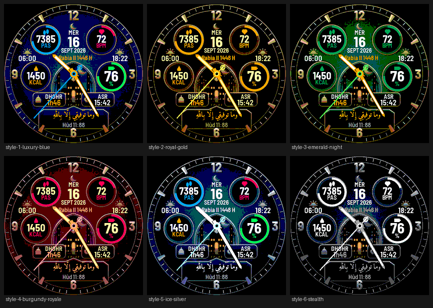

# Luxe Hijri Prayer

Luxury analog-digital Connect IQ **watch face** with Islamic prayer times, written in Monkey C,
for **round colour Garmin watches** — fēnix 7 / 7 Pro / 8, epix 2 / Pro, Enduro 2 / 3,
Forerunner 165 / 255 / 265 / 955 / 965, Venu 2 / 3, vívoactive 5, MARQ 2 — MIP and AMOLED,
218 to 454 px.



> **Status.** The source is complete but **has not been compiled yet**: the Connect IQ SDK
> could not be downloaded where it was written. Images in `docs/previews/` are **reference
> renders** from a Python mirror of the drawing code (same layout, fonts, colours, vector art),
> **not** simulator screenshots. See [`docs/AUDIT.md`](docs/AUDIT.md) and
> [`docs/RELEASE_CHECKLIST.md`](docs/RELEASE_CHECKLIST.md).

## Design

Based on the approved concept image:

* gold 12 / 3 / 6 / 9 numerals, two-tone gold indices, light minute track
* gold baton hands with light lume inserts, long blue seconds hand with hollow counterweight
* date block under 12 (day, large date, month and year) and the Hijri date
* sunrise (left) and sunset (right)
* four ring gauges — steps and heart rate at the top, calories and battery at the sides —
  with icon, value and label; one colour per data type in Luxury Blue and Ice Silver
* a pointed Islamic arch with a night scene (mosque, minarets, palms, water, crescent)
* two cartouches: **next prayer + countdown** and **the following prayer + its time**
* the selected Ayah in Arabic, in a cartouche at the bottom, with its reference

Six style presets recolour everything; four backgrounds (mosque, geometric, black marble,
night sky) change the art; the layout is identical on every screen size.

**HD artwork.** The static part of the dial — background, arch scene, metallic chapter ring,
faceted indices, bevelled numerals, recessed gauges, glass cartouches and fixed icons — is
rendered offline with 3x supersampling, gradients, glows, inner shadows and textures
(`tools/render_hd.py`), once per screen size, style and background: 24 images per size
(`tools/build_hd.py`). Images are stored in full colour; AMOLED devices keep them as JPEG
(`packingFormat="jpg"`), and for MIP devices the compiler converts them to each device's own
palette (Garmin documents 64 colours for the fēnix 7 family in one place and 256 in another;
the compiler uses the device file, so no depth is assumed). MIP previews show the 64-colour case. The watch draws only the live content (texts, gauge arcs,
hands with drop shadows) on top. If an image cannot be loaded, the vector version is used.

Not reproduced from the concept: photographic glow and reflections (vector art instead), the
French translation under the verse (≈6 px at watch size; kept in [`docs/AYAT.md`](docs/AYAT.md)),
and the “GARMIN fēnix” wordmark (Garmin trademark; replaced by a crescent).

## Settings (Garmin Connect app → watch face → Settings)

| Group | Setting | Default |
|---|---|---|
| Appearance | Style Preset (6) | Luxury Blue |
| Appearance | Background (4) | Mosque and crescent moon |
| Appearance | Seconds hand: always / only after wrist raise (MIP) | Always |
| Data Fields | Gauge 1–4: steps, heart rate, calories, battery, distance, floors, Body Battery, stress | Steps, Heart rate, Calories, Battery |
| Faith & Calendar | Hijri Date Correction | 0 days |
| Faith & Calendar | Ayah Selection (7 + none) | Taha 20:114 |
| Faith & Calendar | Prayer calculation method (14) | Tunisia 18°/18° |
| Faith & Calendar | Asr convention | Standard |
| Faith & Calendar | High-latitude rule | Middle of the night |
| Faith & Calendar | Latitude / Longitude | 33.8754 / 10.8575 (Houmt Souk, Djerba) |
| Faith & Calendar | Time zone: watch (auto, DST) / manual UTC offset | Watch |

Coordinates are entered manually (decimal degrees, north and east positive). 0 / 0 is treated as
“not set” and the dial asks to set the location.

## Multiple watches

* All geometry is defined for a 280 × 280 dial (`source/Layout.mc`) and scaled at runtime.
* Bitmap fonts and the Arabic verse glyphs are generated for each screen size (218, 240, 260,
  280, 360, 390, 416, 454 px) and selected by resource qualifiers (`resources-round-WxH/`).
* MIP screens: 64-colour palette, seconds hand in low power through `onPartialUpdate`.
* AMOLED screens (`requiresBurnInProtection`): in always-on mode only thin hands and four dots
  are drawn on black and shifted every minute (about 0.7 % of the pixels lit).
* `manifest.xml` lists the devices whose ids are known; **regenerate the list from your SDK**:
  `python3 tools/update_products.py --write` (selects every round colour device with Connect IQ
  4+ that supports watch faces).

## Project layout

```
manifest.xml, monkey.jungle     project (min API 4.0.0)
source/
  LuxeHijriPrayerApp.mc         app, settings-changed hook, power-budget delegate
  LuxeHijriPrayerView.mc        drawing, static/frame buffers, low-power seconds, AMOLED always-on
  PrayerTimes.mc                prayer/sun algorithm + PrayerSchedule cache
  HijriCalendar.mc, CivilDate.mc
  DataFields.mc                 gauge data sources
  Settings.mc                   validated settings
  Themes.mc, Layout.mc          presets (MIP palette), dial geometry (280-px units)
  Backgrounds.mc                vector art interpreter (scaled)
test/LuxeTests.mc               Monkey C unit tests (:test)
resources/                      strings, settings, properties, 280-px fonts, vector art, icon
resources-round-WxH/            fonts and HD dials for the other screen sizes
resources-fre/                  French strings
tools/                          asset build, validation, layout check, previews, device list
docs/                           audit, calculations, Ayat, store texts, checklist, previews
store/                          store artwork (reference renders)
```

## Build and run (needs the Connect IQ SDK)

1. Install the [Connect IQ SDK Manager](https://developer.garmin.com/connect-iq/sdk/), the
   current SDK and the devices you target, and the *Monkey C* VS Code extension.
2. `python3 tools/update_products.py --write` to align the device list with your SDK.
3. Create a developer key once, **outside** this repository:
   ```sh
   openssl genrsa -out ~/garmin/developer_key.pem 4096
   openssl pkcs8 -topk8 -inform PEM -outform DER -in ~/garmin/developer_key.pem \
       -out ~/garmin/developer_key.der -nocrypt
   ```
4. Compile and start the simulator (repeat `-d` for other devices, e.g. `epix2pro47mm`, `fr265`):
   ```sh
   monkeyc -f monkey.jungle -d fenix7xpro -o bin/LuxeHijriPrayer.prg -y ~/garmin/developer_key.der -w
   connectiq &
   monkeydo bin/LuxeHijriPrayer.prg fenix7xpro
   ```
5. Unit tests:
   ```sh
   monkeyc -f monkey.jungle -d fenix7xpro -o bin/test.prg -y ~/garmin/developer_key.der --unit-test
   monkeydo bin/test.prg fenix7xpro -t
   ```
6. Install on a watch: copy the `.prg` built for that device to `GARMIN/APPS/` over USB.
7. Store package (all devices): `monkeyc -f monkey.jungle -e -r -o bin/LuxeHijriPrayer.iq -y ~/garmin/developer_key.der`,
   upload at <https://apps.garmin.com/developer/> (beta first). Texts: `docs/STORE.md`.

Never commit the developer key: `*.der`, `*.pem`, `*.prg` and `*.iq` are git-ignored.

## Tools (no SDK needed)

```sh
pip install -r tools/requirements.txt      # Pillow (with raqm), adhanpy, astral, convertdate, hijridate
(cd tools && npm install)                   # optional: Monkey C parser for the syntax check
python3 tools/build_assets.py               # fonts per screen size, Ayah glyphs, vector art, icon
python3 tools/build_hd.py                   # HD dial images: 8 sizes x 6 styles x 4 backgrounds (~10 min)
python3 tools/check_project.py              # resources, settings, palette, fonts, syntax
python3 tools/validate_calculations.py      # -> docs/validation-report.md
python3 tools/check_layout.py               # -> docs/layout-report.md (8 screen sizes, EN + FR)
python3 tools/make_previews.py              # -> docs/previews/, store/
```

`tools/face.py` and `tools/luxe_ref/calc.py` mirror the Monkey C drawing code and algorithms;
keep them in sync when changing `source/`.

## Documentation

* [Audit report](docs/AUDIT.md) — starting point, environment limits, design decisions
* [Calculations](docs/CALCULATIONS.md) — prayer method, Hijri convention, limitations
* [Ayah selection](docs/AYAT.md) — verified Arabic text, sources, French translation
* [Validation report](docs/validation-report.md) · [Layout report](docs/layout-report.md)
* [Store listing (EN/FR)](docs/STORE.md) · [Release checklist](docs/RELEASE_CHECKLIST.md)

## Licences

Code: © the author. Fonts: Barlow Semi Condensed and Amiri, SIL Open Font License 1.1
(`tools/fonts-src/OFL-*.txt`); the bitmap fonts in `resources*/fonts/` are derived from them.
Arabic text: Tanzil (CC BY 3.0, unmodified text). French translation: M. Hamidullah via Tanzil
(documentation only).
