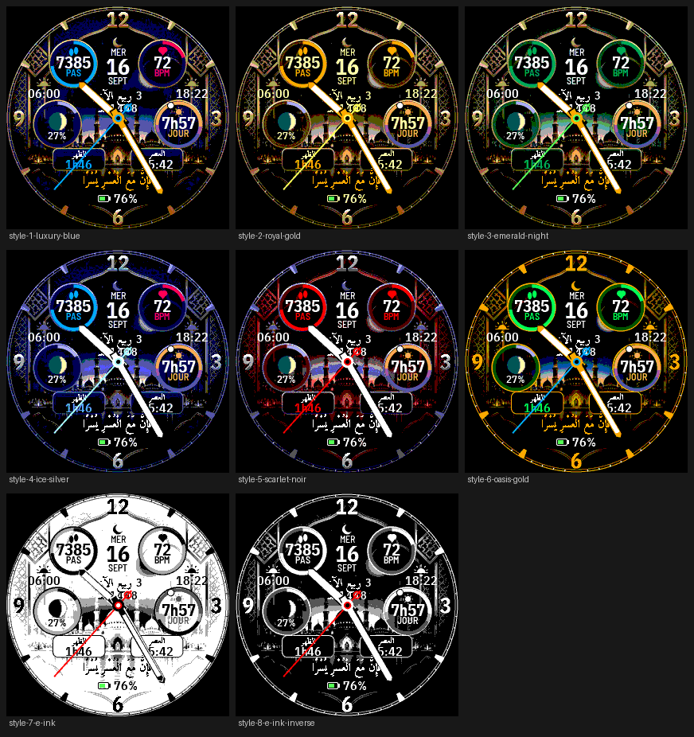

# Luxe Hijri Prayer

Luxury analog-digital Connect IQ **watch face** with Islamic prayer times, written in Monkey C,
for **round colour Garmin watches** — 121 models, MIP and AMOLED, 218 to 466 px:

* **HD dial** (Connect IQ 4+, 70 models): fēnix 7 / 7 Pro / 8 / 8 Pro / 9 / 9 Pro / E, epix 2 / Pro,
  tactix 7 AMOLED / 8, quatix 7 / 8, Enduro 3 / 4, Forerunner 165 / 170 / 255 / 265 / 570 / 70 /
  955 / 965 / 970, Venu 2 / 3 / 4, vívoactive 5 / 6, MARQ 2 / 3, Instinct 3 AMOLED / Crossover
  AMOLED, D2 Mach 1 / 2, D2 Air X10, Descent G2 / Mk3, Approach S50 / S70 / S72.
* **Vector dial** (Connect IQ 3, 51 models): fēnix 5 / 5 Plus / 6 / 6 Pro / Chronos, Forerunner
  245 / 645 / 745 / 935 / 945, MARQ (Gen 1), Venu, vívoactive 3 / 4, Enduro, Descent Mk1 / Mk2,
  D2 Charlie / Delta / Air, Approach S62, vívolife and the Legacy editions. Same functions, with
  the vector backgrounds instead of the HD images (their 96–128 KB of app memory cannot hold them),
  Arabic dial numerals only, and the seconds hand after a wrist raise.



> **Status.** Release candidate 1.0. The watch face compiles with Connect IQ SDK 9.3.0 and runs
> on a fēnix 7X Pro. It is not yet published on the Connect IQ Store. Images in `docs/previews/`
> are **reference renders** from a Python mirror of the drawing code (same layout, fonts,
> colours), **not** simulator or device screenshots. See
> [`docs/RELEASE_CHECKLIST.md`](docs/RELEASE_CHECKLIST.md).

## Design

Based on the approved concept image:

* gold 12 / 3 / 6 / 9 numerals, two-tone gold indices, light minute track
* gold baton hands with light lume inserts, long blue seconds hand with hollow counterweight
* date block under 12 (day, large date, month and year) and the Hijri date
* sunrise (left) and sunset (right)
* the default background is the owner's night illustration of a mosque (`tools/art-src/`),
  colour-graded for each style; the other backgrounds are rendered procedurally
* four ring gauges in smoked glass — steps and heart rate at the top —
  with icon, value and label; one colour per data type in Luxury Blue and Ice Silver
* on the left, a **Moon dial**: the Moon as seen tonight (northern hemisphere), a ring for the
  age of the lunation and the illuminated fraction
* on the right, a 24 h **daylight / darkness ring** (noon at the top): darkness, twilight
  (Fajr → sunrise, sunset → Isha) and daylight, a white dot at the current time, and the time
  left until sunset (DAY) or sunrise (NIGHT)
* a thin metal chapter ring; a battery line under the verse (when no gauge shows the battery)
* large hands with white lume inserts
* a pointed Islamic arch with a night scene (mosque, minarets, palms, water, crescent)
* two cartouches: **next prayer + countdown** and **the following prayer + its time**
* a complete Quranic verse in Arabic at the bottom (without surah name or number), changing every
  hour (39 short verses; see [`docs/AYAT.md`](docs/AYAT.md))
* the Hijri date in Arabic (Eastern Arabic digits, month names, هـ) or in Latin script

Nine style presets recolour everything (two of them, Ember Gold and Oasis Gold, are
high-contrast styles in flat palette colours, readable without the backlight on MIP screens); four backgrounds (mosque, geometric, black marble,
night sky) change the art; the layout is identical on every screen size.

**HD artwork.** The static part of the dial — background, arch scene, metallic chapter ring,
faceted indices, bevelled numerals, recessed gauges, glass cartouches and fixed icons — is
rendered offline with 3x supersampling, gradients, glows, inner shadows and textures
(`tools/render_hd.py`), once per screen size, style and background: 24 images per size
(`tools/build_hd.py`). Images are stored in full colour; AMOLED devices keep them as JPEG
(`packingFormat="jpg"`), and for MIP devices the compiler converts them to each device's own
palette (Garmin documents 64 colours for the fēnix 7 family in one place and 256 in another;
the compiler uses the device file, so no depth is assumed). MIP previews show the 64-colour case. The watch draws only the live content (texts, gauge arcs,
hands with drop shadows) on top. If an image cannot be loaded, the vector version is used.

Not reproduced from the concept: photographic glow and reflections (vector art instead), the
French translation under the verse (≈6 px at watch size; kept in [`docs/AYAT.md`](docs/AYAT.md)),
and the “GARMIN fēnix” wordmark (Garmin trademark; replaced by a crescent).

## Settings

Everything is customisable, in two places that share the same values:

* **on the watch**: hold the menu button on the watch face → *Watch face* → *Settings* (or
  *Customise*), then *Appearance*, *Complications*, *Date & verse*, *Prayers*, *Location*. This
  also works for a sideloaded `.prg`. *Location → Use current position* stores the last GPS
  position known to the watch (start any GPS activity once if none is available).
* **in the Garmin Connect app** (watch face → Settings), for an app installed from the Store.

The settings and the watch menu are generated from `tools/gen_settings.py` (English and French).

| Group | Setting | Choices (default first) |
|---|---|---|
| Appearance | Style | Luxury Blue, Royal Gold, Emerald Night, Burgundy Royale, Ice Silver, Stealth, Scarlet Noir (black, red, white), Ember Gold and Oasis Gold (high contrast) |
| Appearance | Background | Mosque at night (illustration), Islamic geometric pattern, Black marble, Night sky |
| Appearance | Dial numerals | Arabic (12 3 6 9), Indian (Eastern Arabic) |
| Appearance | Font | Modern (Barlow), Classic (Cinzel + Barlow), Sport (Rajdhani) |
| Appearance | Text colour | Preset, white, cream, gold, silver, ice blue |
| Appearance | Accent colour (countdown, gauges) | Preset, red, orange, gold, green, cyan, blue, white |
| Appearance | Hands / hands colour | Baton with lume, Dauphine, Sword / preset, gold, rose gold, silver, bronze |
| Appearance | Seconds hand / colour | Always, only after wrist raise, hidden / preset + 7 colours |
| Data fields | Gauges 1–4 | Steps, heart rate, calories, battery, distance, floors, Body Battery, stress, active minutes (week), none, daylight / darkness (24 h), Moon phase; default steps, heart rate, Moon, daylight |
| Data fields | Gauge colours | One colour per data type, accent colour, text colour |
| Faith & calendar | Hijri date script / digits / correction | Arabic, Latin / Arabic (1 2 3), Indian digits / −2…+2 days (0) |
| Faith & calendar | Ayah | Hourly rotation (ticked verses), fixed verse, hidden |
| Faith & calendar | Fixed verse + 39 “Rotation” check boxes | Ash-Sharh 94:5; all ticked |
| Faith & calendar | Prayer method, Asr, high-latitude rule | Tunisia 18°/18°, standard, middle of the night |
| Faith & calendar | Prayer names | Arabic (الفجر …), Latin script |
| Faith & calendar | Adjust Fajr / Dhuhr / Asr / Maghrib / Isha | −30…+30 min each (0, a number in Garmin Connect), to match a mosque timetable |
| Faith & calendar | Location | Automatic (follows the watch's GPS position), manual |
| Faith & calendar | Latitude / longitude / time zone | 33.8754 / 10.8575 (Houmt Souk, Djerba) / watch time zone |

In automatic mode the watch face stores the watch's GPS position (as known from the last GPS
activity) whenever it moves by more than about 3 km and recomputes the prayer times. In manual
mode the coordinates are entered in decimal degrees (north and east positive). 0 / 0 is treated
as “not set” and the dial asks to set the location.

**Mawaqit.** Prayer times are computed on the watch. Mawaqit's API is private ("Our API is
currently private"): its mosque search answers HTTP 401 without an access token (tested on
2026-11-03), so mosque timetables cannot be fetched without Mawaqit's agreement.

## Multiple watches

* All geometry is defined for a 280 × 280 dial (`source/Layout.mc`) and scaled at runtime.
* Bitmap fonts and the Arabic verse glyphs are generated for each screen size (218, 240, 260,
  280, 360, 390, 416, 454 px) and selected by resource qualifiers (`resources-round-WxH/`).
* MIP screens: 64-colour palette, seconds hand in low power through `onPartialUpdate`.
* AMOLED screens (`requiresBurnInProtection`): in always-on mode only thin hands and four dots
  are drawn on black and shifted every minute (about 0.7 % of the pixels lit).
* `manifest.xml` lists the devices whose ids are known; **regenerate the list from your SDK**:
  `python3 tools/update_products.py --write` (selects every round colour device with Connect IQ
  4+ that supports watch faces).

## Project layout

```
manifest.xml, monkey.jungle     project (min API 4.0.0)
source/
  LuxeHijriPrayerApp.mc         app, settings-changed hook, power-budget delegate
  LuxeHijriPrayerView.mc        drawing, static/frame buffers, low-power seconds, AMOLED always-on
  PrayerTimes.mc                prayer/sun algorithm + PrayerSchedule cache
  HijriCalendar.mc, CivilDate.mc
  DataFields.mc                 gauge data sources
  Settings.mc                   validated settings
  Themes.mc, Layout.mc          presets (MIP palette), dial geometry (280-px units)
  Backgrounds.mc                vector art interpreter (scaled)
test/LuxeTests.mc               Monkey C unit tests (:test)
resources/                      strings, settings, properties, 280-px fonts, vector art, icon
resources-round-WxH/            fonts and HD dials for the other screen sizes
resources-fre/                  French strings
tools/                          asset build, validation, layout check, previews, device list
docs/                           calculations, Ayat, store texts, checklist, previews
store/                          store artwork (reference renders)
```

## Compile a preview without installing anything (GitHub Actions)

`.github/workflows/build.yml` compiles the watch face with the official SDK on GitHub's servers:

1. Read the Connect IQ SDK license agreement. If you accept it, add the repository **variable**
   `CIQ_ACCEPT_LICENSE` = `yes` (Settings → Secrets and variables → Actions → Variables).
2. Add the **secrets** `GARMIN_USERNAME` and `GARMIN_PASSWORD` (your Garmin account: the SDK
   device files require a login). They are encrypted and never appear in the code or the logs.
3. Push, or run *Actions → Build → Run workflow* (mode `preview`, `all` or `iq`).
4. Download the artifact *LuxeHijriPrayer-…*: one `.prg` per device
   (`fr255s`, `fenix7s`, `fenix7`, `fenix7xpro`, `venu2s`, `fr165`, `epix2pro47mm`,
   `epix2pro51mm` in preview mode), the unit-test build and the compiler logs.

Without the secret below, the `.prg` files are signed with a temporary key: they are for the
simulator or sideloading (`GARMIN/APPS/`). The static checks (no SDK) run on every push as well.

### Store package

The Store requires every version of the app to be signed with **the same** developer key.

1. Create the key once, on your computer, and keep a backup outside the repository. On Windows,
   the easiest is VS Code with the *Monkey C* extension: *Ctrl+Shift+P → Monkey C: Generate a
   Developer Key* (it writes `developer_key.der`). Or with OpenSSL (step 3 of the next section).
2. Encode it and copy it (PowerShell):
   `[Convert]::ToBase64String([IO.File]::ReadAllBytes("C:\chemin\developer_key.der")) | Set-Clipboard`
3. Repository *Settings → Secrets and variables → Actions → New repository secret*:
   name `CIQ_DEVELOPER_KEY`, value = the pasted text. It is encrypted, never shown in the logs,
   and the key file is deleted from the runner at the end of each job.
4. *Actions → Build → Run workflow*, mode `iq`: the artifact contains `LuxeHijriPrayer.iq`, ready
   to upload at <https://apps.garmin.com/developer/>. Without the secret the `iq` build stops
   with an error instead of producing a package signed with a throw-away key.

## Build and run (needs the Connect IQ SDK)

1. Install the [Connect IQ SDK Manager](https://developer.garmin.com/connect-iq/sdk/), the
   current SDK and the devices you target, and the *Monkey C* VS Code extension.
2. `python3 tools/update_products.py --write` to align the device list with your SDK.
3. Create a developer key once, **outside** this repository:
   ```sh
   openssl genrsa -out ~/garmin/developer_key.pem 4096
   openssl pkcs8 -topk8 -inform PEM -outform DER -in ~/garmin/developer_key.pem \
       -out ~/garmin/developer_key.der -nocrypt
   ```
4. Compile and start the simulator (repeat `-d` for other devices, e.g. `epix2pro47mm`, `fr265`):
   ```sh
   monkeyc -f monkey.jungle -d fenix7xpro -o bin/LuxeHijriPrayer.prg -y ~/garmin/developer_key.der -w
   connectiq &
   monkeydo bin/LuxeHijriPrayer.prg fenix7xpro
   ```
5. Unit tests:
   ```sh
   monkeyc -f monkey.jungle -d fenix7xpro -o bin/test.prg -y ~/garmin/developer_key.der --unit-test
   monkeydo bin/test.prg fenix7xpro -t
   ```
6. Install on a watch: copy the `.prg` built for that device to `GARMIN/APPS/` over USB.
7. Store package (all devices): `monkeyc -f monkey.jungle -e -r -o bin/LuxeHijriPrayer.iq -y ~/garmin/developer_key.der`,
   upload at <https://apps.garmin.com/developer/> (beta first). Texts: `docs/STORE.md`.

Never commit the developer key: `*.der`, `*.pem`, `*.prg` and `*.iq` are git-ignored.

## Tools (no SDK needed)

```sh
pip install -r tools/requirements.txt      # Pillow (with raqm), adhanpy, astral, convertdate, hijridate
(cd tools && npm install)                   # optional: Monkey C parser for the syntax check
python3 tools/gen_settings.py               # settings, properties and their EN/FR strings
python3 tools/build_assets.py               # fonts per screen size and family, Ayah fonts, vector art, icon
python3 tools/gen_ayat_doc.py               # -> docs/AYAT.md
python3 tools/build_hd.py                   # HD dial images: 9 sizes x 9 styles x 4 backgrounds (~15 min)
python3 tools/check_project.py              # resources, settings, palette, fonts, syntax
python3 tools/validate_calculations.py      # -> docs/validation-report.md
python3 tools/check_layout.py               # -> docs/layout-report.md (8 screen sizes, EN + FR)
python3 tools/make_previews.py              # -> docs/previews/, store/
tools/ci_build.sh <key.der> preview         # compile with a local SDK (preview | all | iq | tests)
```

`tools/face.py` and `tools/luxe_ref/calc.py` mirror the Monkey C drawing code and algorithms;
keep them in sync when changing `source/`.

## Documentation

* [Calculations](docs/CALCULATIONS.md) — prayer method, Hijri convention, limitations
* [Ayah selection](docs/AYAT.md) — verified Arabic text, sources, French translation
* [Validation report](docs/validation-report.md) · [Layout report](docs/layout-report.md)
* [Store listing (EN/FR)](docs/STORE.md) · [Release checklist](docs/RELEASE_CHECKLIST.md)

## Licences

Code: © the author. Background illustration `tools/art-src/mosque-night.png`: supplied by the
owner. Fonts: Barlow Semi Condensed (Bold, SemiBold, Medium), Cinzel, Rajdhani and Amiri, SIL Open Font License 1.1
(`tools/fonts-src/OFL-*.txt`); the bitmap fonts in `resources*/fonts/` are derived from them.
Arabic text: Tanzil (CC BY 3.0, unmodified text). French translation: M. Hamidullah via Tanzil
(documentation only).
